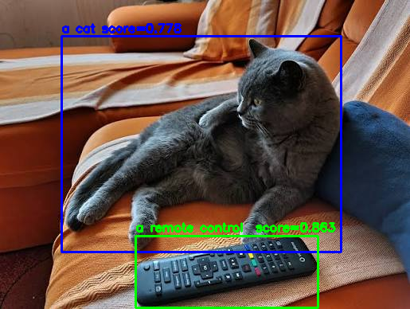
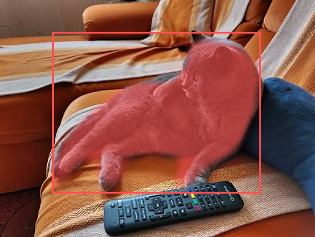
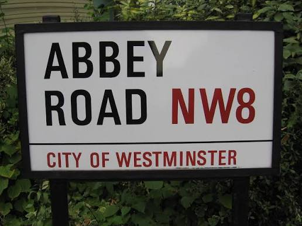
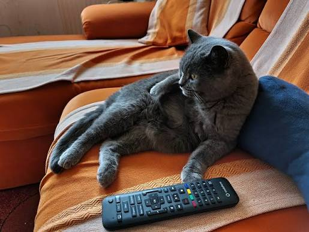
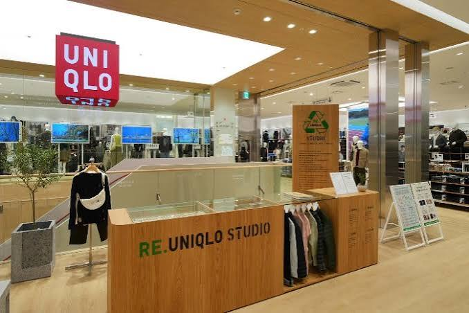

# VLM/VLA Tutorial
1. OWLv2 (Open-World Localization v2) - is open-vocabulary detector. CLIP matches each image patch to the text queries, and the detection heads output a box without text generation.  
**Example**:  
<div align="center">
     
</div>  

2. PaliGemma 2 is a generative vision-language model: SigLIP plus Gemma 2. Caption, question answering, OCR, detection and segmentation are the same text decoder, the task depends on the prompt. A box is 4 location tokens, a mask is 16 codes that a separate VQ-VAE transform into pixel from quantized representation.  
**Example**:  
<div align="center">
     
</div>  

<div align="center">
     
</div>  

**Generate `OCR` output:** 
```
Generated text
ABBEY
ROAD NW8
CITY OF WESTMINSTER<eos>
```
**Generate `caption en` output:** 
```
A cat laying on a couch next to a remote control.
```
   
3. Molmo2 is also a generative vision-language model (vision model + Qwen3). The same decoder is used for captions, answers and points.   
**Example**:  
<div align="center">
     
</div>  

**Generate output**: 
```
In this image, a gray cat is lounging comfortably on an orange couch. The cat is lying on its side with its head resting on a blue pillow, and its front paws stretched out in front of it. The cat's eyes are open, and it appears to be looking off to the side, perhaps
```

5. [Introduction VLM notebook](https://github.com/Xrenya/VLM-VLA/VLM_1.ipynb): short introduction into how VLM training is done with the simple examples:
   -  VLM training stage for different models (about attention and MMDiT arch see [repo](https://github.com/Xrenya/stable_diffusion)
   -  Sample Packing (Multipack)
   -  4D mask for attention and RoPE embeddings correct calculation
   -  Inference of the finetuned model (mentioned importance of usage KV-cache, can be found in this [tutorial](https://github.com/Xrenya/pytorch-seq2seq/blob/main/7_KVCaching.ipynb))

The model was trained on 491M tokens, but overall make decent predictions.  
**Example**:  
<div align="center">
     
</div>  

**Generate output**:   
> [!NOTE]
> The image displays an indoor setting with a large, open-air display featuring a variety of clothing items.
> The display is positioned in front of a large, wooden sign with the text "UNIDO" in white letters,
> which is surrounded by a green background. The sign is positioned on a wooden floor,
> and the sign is adorned with a green and white banner with the text "UNIDO" in white letters.

Model weights: 🤗[Xrenya/smolVLM](https://huggingface.co/Xrenya/smolVLM)

2. Introduction VLA with Linear projection heads notebook
3. Introduction VLA with diffusion head notebook
